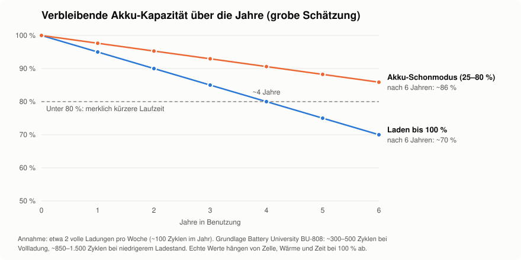
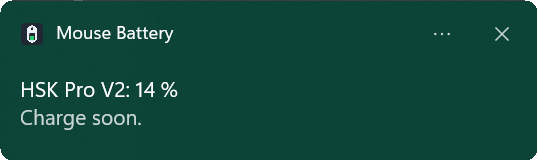

# Mouse Battery

**Akkustand deiner G-Wolves-Maus – ohne extra Software zu öffnen.**

Ein kleines, kostenloses Windows-Hintergrundprogramm. Kein Fenster, kein Taskleisten-Symbol, kein Konto, kein Tracking.
Beim ersten Mal eine kurze Einrichtung – danach läuft es einfach.

[**⬇ Herunterladen**](../../../releases/latest) · [In 1 Minute installiert](#-installation) · [💬 Feedback ohne Konto](https://docs.google.com/forms/d/e/1FAIpQLScsMFl2yEgZeK9XnnpdxrZ11qGO5dJ4ZLNxyg6os8Y4bVqsmg/viewform) · [🇬🇧 English](../README.md)

> 💬 **Deine Ideen machen dieses Programm besser.** Dir fehlt etwas, du willst eine andere Warnstufe, oder deine Maus wird nicht erkannt? [Schreib mir kurz – ohne Konto](https://docs.google.com/forms/d/e/1FAIpQLScsMFl2yEgZeK9XnnpdxrZ11qGO5dJ4ZLNxyg6os8Y4bVqsmg/viewform) oder [öffne ein Issue](../../../issues/new/choose) – ich lese alles und baue gern Änderungen ein. Deutsch oder Englisch, ganz ohne GitHub-Erfahrung.

---

## ✨ Das Wichtigste

### 🎬 Einmalige Demo und Einrichtung – danach bleibt nichts übrig
Direkt nach der Installation zeigt dir das Programm eine **30-Sekunden-Demo** in drei Meldungen: wie dein Akkustand aussieht, wie eine Warnung aussieht – und eine Frage:

> **Akku schonen?** &nbsp; `Ja` · `Nein`

- **Ja** → der [Akku-Schonmodus](#-akku-schonmodus) ist an. Du bekommst eine kurze Erklärung, wie er abläuft, und den Tipp mit dem [eigenen Ladekabel](#-tipp-ein-eigenes-kabel-zum-laden).
- **Nein** → das Programm läuft ganz normal weiter.

Das ist die einzige Frage, und sie kommt **nur ein einziges Mal**. Danach ist die Einrichtung weg: kein Einstellungsfenster, keine Schalter, keine übrig gebliebenen Einrichtungsdateien – das Programm bleibt so klein wie möglich. **Doch anders entschieden?** Einfach deinstallieren und neu installieren (dauert eine Minute) – Demo und Frage kommen dann noch einmal.

### 🎮 Warnungen warten, bis du das Spiel verlässt
Eine Warnung bei wenig Akku kommt nicht in dem Moment, in dem der Akku sinkt. Sie **wartet auf deinen nächsten Fensterwechsel** – Windows-Taste, Alt+Tab oder Klick in ein anderes Fenster. So stört sie nie, während du zielst; du siehst sie, sobald du das Spiel sowieso verlässt. Nur wenn der Akku wirklich leer ist, kommt sie sofort. Auch die normale stündliche Meldung wartet, solange ein Spiel oder Video im Vollbild läuft.

### 👆 Meldung anklicken
- **Beim ersten Mal:** Du wählst, welche offizielle G-Wolves-Seite sich öffnen soll – **Webtreiber** ([mouse.xyz](https://www.mouse.xyz/), der offizielle „G-Wolves Mouse Web Driver“), **Downloads** (offizielle Software- und Firmware-Seite) oder **Shop**. Deine Wahl wird gespeichert.
- **Ab dann:** Ein Klick auf eine frische Meldung öffnet deine Seite **automatisch** – praktisch, um gleich DPI oder Polling-Rate zu ändern.
- **Die Meldung geht nicht verloren:** Nachdem deine Seite aufgeht, landet still eine frische Meldung mit dem aktuellen Stand im Mitteilungscenter (ohne Einblendung). Dort liegt also immer eine zum Anklicken bereit.
- **<kbd>Strg</kbd> gedrückt halten und anklicken** → die Auswahl der Seiten kommt wieder. Nützlich, falls eine Seite einmal abgeschaltet wird oder umzieht. Das ist der einzige Weg, sie zu ändern – und die einzige Option überhaupt.
- **Ältere Meldung** im Mitteilungscenter (<kbd>Win</kbd>+<kbd>N</kbd>) → zuerst kommt eine **frische mit dem aktuellen Stand**. Die anklicken → deine Seite. So wird das Mitteilungscenter zum schnellen „Wie voll ist meine Maus gerade?“-Knopf.

Das Programm selbst geht nie ins Internet – nur dein Browser, wenn du klickst.

### 🔌 Meldungen beim Laden
Steckst du ein, zählt das Programm **in 10-%-Schritten** mit – ab einem vollen Schritt über dem Stand beim Einstecken, damit nicht sofort eine überflüssige Meldung kommt:

- eingesteckt bei **70 %** → 80, 90, 100 %
- eingesteckt bei **18 %** → 30, 40, 50 … 100 %

Bei 100 % steht da **„Voll geladen.“** Alles ohne Ton; läuft ein Spiel im Vollbild, warten die Meldungen bis zum nächsten Fensterwechsel.

### 🌱 Akku-Schonmodus
Lithium-Akkus altern am schnellsten, wenn sie lange bei **100 %** stehen und wenn sie **fast leer** gefahren werden. Hält man sie etwa zwischen **25 und 80 %**, halten sie spürbar mehr Jahre. Antwortest du in der Einrichtung mit **Ja**, hilft dir das Programm genau dabei:

| | Normal | Akku-Schonmodus |
|---|---|---|
| Beim Laden | Schritte bis 100 % | Schritte bis 80 %, dann **„Jetzt abstecken – schont den Akku.“** (mit Ton, bleibt bis OK) |
| Erste Warnung | 30 % – ohne Ton | **40 %** – ohne Ton, nur ein Hinweis |
| Mit Ton | 15 % | **30 %** |
| Bleibt bis OK | 10 % | **25 %** – jetzt laden |
| Sofort, auch im Spiel | 5 % | **15 %** |

Die Warnungen bei 40 % und 30 % sind bewusst sanft – du kannst entspannt bis etwa 25 % weiterspielen.

> Das ist eine grobe Schätzung, keine Messung an einem G-Wolves-Akku. Das Programm kann das Laden nicht stoppen – es sagt dir nur, wann du abstecken solltest. Nicht für jeden: Wer nicht darüber nachdenken will, antwortet mit **Nein** und ist mit dem normalen Modus gut bedient.

### 💡 Tipp: ein eigenes Kabel zum Laden
Viele laden, indem sie das Kabel aus dem Empfänger-Dock ziehen, in die Maus stecken – und danach wieder zurück. Macht man das alle paar Tage, leidet der **USB-C-Anschluss am Empfänger-Dock**. Bekommt er einen Wackelkontakt, kann die Funkverbindung mitten im Spiel abbrechen oder stocken.

So mache ich es selbst: Das Empfänger-Kabel **bleibt dauerhaft eingesteckt**, geladen wird mit einem **zweiten USB-C-Kabel** an einem anderen USB-Anschluss. Der Empfänger wird nie bewegt, also kann er keinen Wackelkontakt bekommen.

Das ist meine persönliche Empfehlung – nicht für jeden. Man braucht ein zweites Kabel und einen freien USB-Anschluss, und wer nur ein Kabel auf dem Tisch haben will, kann auch gut umstecken.

### 🖱️ Alle kabellosen G-Wolves-Mäuse, automatisch erkannt
Empfänger (oder Kabel) einstecken – das Programm findet die Maus und nutzt ihren echten Namen. Mehrere Mäuse gleichzeitig gehen auch; jede bekommt ihre eigene Meldung.

---

## 📸 Alle Meldungen auf einen Blick

| Meldung | So sieht sie aus | Wann sie kommt |
|---|---|---|
| **PC-Start** |  | Erste Antwort der Maus nach dem PC-Start – sofort, auch im Vollbild. Ohne Ton. |
| **Jede Stunde** |  | Nichts im Vollbild: sofort, ohne Ton. Etwas im Vollbild: wartet auf den nächsten Fensterwechsel. |
| **Maus aufgewacht** |  | Eine Stunde ist um, aber die Maus schlief: sobald du sie bewegst – sofort **mit Ton**, auch im Vollbild. |
| **Lädt** |  | Beim Laden alle 10 % (siehe oben), mit „Lädt gerade.“ als zweiter Zeile. Ohne Ton. |
| **Voll geladen** | – | Lädt und steht bei 100 %. Ohne Ton. |
| **Jetzt abstecken** | – | Nur im Akku-Schonmodus: bei 80 % beim Laden. Mit Ton, bleibt bis **OK**. |
| **30 %** (Schonmodus: 40 %) |  | Beim nächsten Fensterwechsel. Ohne Ton. |
| **15 %** (Schonmodus: 30 %) |  | Beim nächsten Fensterwechsel. Mit Ton. |
| **10 %** (Schonmodus: 25 %) und darunter |  | Beim nächsten Fensterwechsel. Mit Ton, **bleibt bis du OK klickst**. Darunter jede Minute erneut (bei deinen Fensterwechseln). |
| **5 %** (Schonmodus: 15 %) und darunter |  | **Sofort, auch im Spiel**, jede Minute. Mit Ton, bleibt bis **OK**. |

Jede neue Meldung ersetzt die vorige derselben Maus, und es wird nur die neueste Warnung gezeigt. Alle Warnungen werden zurückgesetzt, sobald du lädst.

> Die Farbe kommt von deiner Windows-Akzentfarbe – siehe [Häufige Fragen](#-häufige-fragen).

## 🧰 Außerdem
- **Liest** nur den Akkustand. Es schickt nie etwas, das deine Maus-Einstellungen ändert.
- **Läuft komplett offline** – alles Nötige steckt in der `.exe`.
- Braucht sehr wenig Speicher und praktisch 0 % CPU.
- Deutsch und Englisch – richtet sich nach deiner Windows-Sprache.
- Doppelklick auf das Programm, während es läuft → zeigt sofort den aktuellen Stand.
- Schreibt einen kleinen Verlauf (`history.csv`), damit du siehst, wie lange eine Ladung hält.

## 📥 Installation
1. `MouseBattery.exe` [**herunterladen**](../../../releases/latest) – immer die neueste Version.
2. Doppelklicken und mit **Ja** antworten.
3. Die kurze Demo ansehen und die Akku-Frage beantworten. Fertig – es läuft im Hintergrund und startet mit Windows.

Keine Admin-Rechte und keine .NET-Installation nötig. Windows 10 oder 11 (64 Bit).

> **Windows SmartScreen** warnt eventuell, weil die Datei neu und nicht signiert ist. Klicke auf **Weitere Informationen** → **Trotzdem ausführen**. Der komplette Quellcode liegt hier im Repository, die `.exe` wird von GitHub Actions daraus gebaut.

**Aktualisieren:** neue `MouseBattery.exe` herunterladen und doppelklicken – sie ersetzt die alte und behält deine Antworten.
**Deinstallieren:** *Einstellungen → Apps → Installierte Apps → Mouse Battery → Deinstallieren*. Das entfernt alles, auch deine Antworten.

## 🖱️ Unterstützte Mäuse

### Mit deiner Maus getestet? Sag's mir in 10 Sekunden – ohne Konto: [**👉 Geht / geht nicht**](https://docs.google.com/forms/d/e/1FAIpQLScsMFl2yEgZeK9XnnpdxrZ11qGO5dJ4ZLNxyg6os8Y4bVqsmg/viewform)

Alle G-Wolves-Modelle, die der offizielle Webkonfigurator kennt (Stand November 2026), sind eingebaut. ✅ = von einem echten Nutzer bestätigt. Klick auf ein ❔, um deine zu bestätigen – jede Antwort hilft dem Nächsten.

| Maus | Status |
|---|---|
| Fenrir | [❔ noch nicht bestätigt – getestet?](https://docs.google.com/forms/d/e/1FAIpQLScsMFl2yEgZeK9XnnpdxrZ11qGO5dJ4ZLNxyg6os8Y4bVqsmg/viewform) |
| Fenrir Asym | [❔ noch nicht bestätigt – getestet?](https://docs.google.com/forms/d/e/1FAIpQLScsMFl2yEgZeK9XnnpdxrZ11qGO5dJ4ZLNxyg6os8Y4bVqsmg/viewform) |
| Fenrir Max | [❔ noch nicht bestätigt – getestet?](https://docs.google.com/forms/d/e/1FAIpQLScsMFl2yEgZeK9XnnpdxrZ11qGO5dJ4ZLNxyg6os8Y4bVqsmg/viewform) |
| Fenrir Max Asym | [❔ noch nicht bestätigt – getestet?](https://docs.google.com/forms/d/e/1FAIpQLScsMFl2yEgZeK9XnnpdxrZ11qGO5dJ4ZLNxyg6os8Y4bVqsmg/viewform) |
| **Fenrir Pro** | ✅ bestätigt (Receiver RS) |
| HSK Lite | [❔ noch nicht bestätigt – getestet?](https://docs.google.com/forms/d/e/1FAIpQLScsMFl2yEgZeK9XnnpdxrZ11qGO5dJ4ZLNxyg6os8Y4bVqsmg/viewform) |
| HSK Plus | [❔ noch nicht bestätigt – getestet?](https://docs.google.com/forms/d/e/1FAIpQLScsMFl2yEgZeK9XnnpdxrZ11qGO5dJ4ZLNxyg6os8Y4bVqsmg/viewform) |
| HSK Plus ACE | [❔ noch nicht bestätigt – getestet?](https://docs.google.com/forms/d/e/1FAIpQLScsMFl2yEgZeK9XnnpdxrZ11qGO5dJ4ZLNxyg6os8Y4bVqsmg/viewform) |
| HSK Pro | [❔ noch nicht bestätigt – getestet?](https://docs.google.com/forms/d/e/1FAIpQLScsMFl2yEgZeK9XnnpdxrZ11qGO5dJ4ZLNxyg6os8Y4bVqsmg/viewform) |
| HSK Pro ACE | [❔ noch nicht bestätigt – getestet?](https://docs.google.com/forms/d/e/1FAIpQLScsMFl2yEgZeK9XnnpdxrZ11qGO5dJ4ZLNxyg6os8Y4bVqsmg/viewform) |
| **HSK Pro V2** | ✅ bestätigt |
| HT-S2 | [❔ noch nicht bestätigt – getestet?](https://docs.google.com/forms/d/e/1FAIpQLScsMFl2yEgZeK9XnnpdxrZ11qGO5dJ4ZLNxyg6os8Y4bVqsmg/viewform) |
| HT-S2 Pro | [❔ noch nicht bestätigt – getestet?](https://docs.google.com/forms/d/e/1FAIpQLScsMFl2yEgZeK9XnnpdxrZ11qGO5dJ4ZLNxyg6os8Y4bVqsmg/viewform) |
| HTM Plus | [❔ noch nicht bestätigt – getestet?](https://docs.google.com/forms/d/e/1FAIpQLScsMFl2yEgZeK9XnnpdxrZ11qGO5dJ4ZLNxyg6os8Y4bVqsmg/viewform) |
| HTR | [❔ noch nicht bestätigt – getestet?](https://docs.google.com/forms/d/e/1FAIpQLScsMFl2yEgZeK9XnnpdxrZ11qGO5dJ4ZLNxyg6os8Y4bVqsmg/viewform) |
| HTR Pro | [❔ noch nicht bestätigt – getestet?](https://docs.google.com/forms/d/e/1FAIpQLScsMFl2yEgZeK9XnnpdxrZ11qGO5dJ4ZLNxyg6os8Y4bVqsmg/viewform) |
| HTS Plus | [❔ noch nicht bestätigt – getestet?](https://docs.google.com/forms/d/e/1FAIpQLScsMFl2yEgZeK9XnnpdxrZ11qGO5dJ4ZLNxyg6os8Y4bVqsmg/viewform) |
| HTS Plus ACE | [❔ noch nicht bestätigt – getestet?](https://docs.google.com/forms/d/e/1FAIpQLScsMFl2yEgZeK9XnnpdxrZ11qGO5dJ4ZLNxyg6os8Y4bVqsmg/viewform) |
| HTS Plus Pro | [❔ noch nicht bestätigt – getestet?](https://docs.google.com/forms/d/e/1FAIpQLScsMFl2yEgZeK9XnnpdxrZ11qGO5dJ4ZLNxyg6os8Y4bVqsmg/viewform) |
| HTS Ultra | [❔ noch nicht bestätigt – getestet?](https://docs.google.com/forms/d/e/1FAIpQLScsMFl2yEgZeK9XnnpdxrZ11qGO5dJ4ZLNxyg6os8Y4bVqsmg/viewform) |
| HTX | [❔ noch nicht bestätigt – getestet?](https://docs.google.com/forms/d/e/1FAIpQLScsMFl2yEgZeK9XnnpdxrZ11qGO5dJ4ZLNxyg6os8Y4bVqsmg/viewform) |
| HTX ACE | [❔ noch nicht bestätigt – getestet?](https://docs.google.com/forms/d/e/1FAIpQLScsMFl2yEgZeK9XnnpdxrZ11qGO5dJ4ZLNxyg6os8Y4bVqsmg/viewform) |
| HTX Mini | [❔ noch nicht bestätigt – getestet?](https://docs.google.com/forms/d/e/1FAIpQLScsMFl2yEgZeK9XnnpdxrZ11qGO5dJ4ZLNxyg6os8Y4bVqsmg/viewform) |
| HTX Mini Asym | [❔ noch nicht bestätigt – getestet?](https://docs.google.com/forms/d/e/1FAIpQLScsMFl2yEgZeK9XnnpdxrZ11qGO5dJ4ZLNxyg6os8Y4bVqsmg/viewform) |
| HTXU | [❔ noch nicht bestätigt – getestet?](https://docs.google.com/forms/d/e/1FAIpQLScsMFl2yEgZeK9XnnpdxrZ11qGO5dJ4ZLNxyg6os8Y4bVqsmg/viewform) |
| Lycan | [❔ noch nicht bestätigt – getestet?](https://docs.google.com/forms/d/e/1FAIpQLScsMFl2yEgZeK9XnnpdxrZ11qGO5dJ4ZLNxyg6os8Y4bVqsmg/viewform) |
| VUK | [❔ noch nicht bestätigt – getestet?](https://docs.google.com/forms/d/e/1FAIpQLScsMFl2yEgZeK9XnnpdxrZ11qGO5dJ4ZLNxyg6os8Y4bVqsmg/viewform) |
| VUK Mini | [❔ noch nicht bestätigt – getestet?](https://docs.google.com/forms/d/e/1FAIpQLScsMFl2yEgZeK9XnnpdxrZ11qGO5dJ4ZLNxyg6os8Y4bVqsmg/viewform) |
| WARG | [❔ noch nicht bestätigt – getestet?](https://docs.google.com/forms/d/e/1FAIpQLScsMFl2yEgZeK9XnnpdxrZ11qGO5dJ4ZLNxyg6os8Y4bVqsmg/viewform) |

Geht nicht, oder deine Maus fehlt? Nutze [dasselbe Formular](https://docs.google.com/forms/d/e/1FAIpQLScsMFl2yEgZeK9XnnpdxrZ11qGO5dJ4ZLNxyg6os8Y4bVqsmg/viewform) oder [öffne ein Issue](../../../issues/new/choose) – eine neue Maus ist oft nur eine Zeile Code.

## ⚙️ Erweiterte Einstellungen (optional)
Brauchst du nicht – die einmalige Einrichtung deckt alles ab. Für Bastler: `%LOCALAPPDATA%\MouseBattery\config.json` (in die Adresszeile des Explorers einfügen) enthält deine Antworten aus der Einrichtung, und du kannst dort selbst die Werte unten ergänzen. Danach das Programm neu starten (oder ab- und wieder anmelden). Deine Einrichtungs-Antworten selbst (Schonmodus, Seite) änderst du durch Neuinstallieren, die Seite auch mit <kbd>Strg</kbd>+Klick.

Alle Werte

| Einstellung | Standard | Bedeutung |
|---|---|---|
| `Language` | `auto` | `auto`, `en` oder `de` |
| `InfoEveryHours` | `1` | wie oft die normale Meldung kommt |
| `FirstWarningPercent` | `30` | Warnung ohne Ton |
| `SecondWarningPercent` | `15` | Warnung mit Ton |
| `ThirdWarningPercent` | `10` | Warnung, die bis **OK** stehen bleibt |
| `ImmediatePercent` | `5` | Warnung sofort, auch im Spiel |
| `RepeatSeconds` | `60` | Wiederholung unterhalb der „bleibt bis OK“-Stufe |
| `CheckIntervalSeconds` | `10` | wie oft der Akku gelesen wird |
| `ChargeStepPercent` | `10` | beim Laden eine Meldung alle so viele Prozent; `0` = aus |
| `ChargeLimitPercent` | `0` | beim Laden „Jetzt abstecken“ bei diesem Stand; `0` = aus |
| `FreshSeconds` | `60` | Meldung jünger als das öffnet beim Klick deine Seite; eine ältere zeigt stattdessen eine frische Meldung |
| `WarningSound` | `""` | eigene `.wav` für Meldungen mit Ton |
| `UrgentSound` | `""` | eigene `.wav` für Warnungen, die bis OK stehen bleiben |
| `MouseNames` | `{}` | eigene Namen, z. B. `{ "5817": "Meine HSK" }` (Produkt-ID aus `log.txt`) |

Im Akku-Schonmodus sind die Warnstufen fest auf 40 / 30 / 25 / 15 % und die Ladegrenze auf 80 %.

## ❓ Häufige Fragen

**Ich bekomme keine Meldung.**
Prüfe, ob Meldungen für *Mouse Battery* unter *Einstellungen → System → Benachrichtigungen* an sind und *Nicht stören* aus ist. Bei *Nicht stören* landen Meldungen direkt im Mitteilungscenter (<kbd>Win</kbd>+<kbd>N</kbd>). Das Protokoll liegt in `%LOCALAPPDATA%\MouseBattery\log.txt`.

**Die gewählte Seite funktioniert nicht mehr.**
<kbd>Strg</kbd> gedrückt halten und eine Meldung anklicken – die Auswahl der offiziellen G-Wolves-Seiten kommt wieder.

**Ich will meine Antwort zum Akku-Schonmodus ändern.**
Deinstallieren (*Einstellungen → Apps*) und neu installieren – Demo und Frage kommen noch einmal. Das ist Absicht: kein Einstellungsfenster, nichts Überflüssiges bleibt auf deinem PC.

**Warum ist die Meldung auf den Bildern grün?**
Windows färbt Meldungen in deiner **Akzentfarbe**. Die Bilder sind nur grün, weil die Akzentfarbe des Entwicklers grün ist – bei dir erscheinen sie in deiner eigenen Farbe (*Einstellungen → Personalisierung → Farben*).

**Ich höre keinen Ton.**
Das Programm nutzt den Windows-Meldungston aus deinem Soundschema (*Benachrichtigung*, und *Erinnerung* bei Meldungen mit **OK**-Knopf). Hast du eine eigene `.wav` gewählt, die **außerhalb von `C:\Windows\Media`** liegt, bleiben Meldungen still: Der Windows-Meldungsdienst darf solche Dateien nicht lesen. Das betrifft alle Programme, nicht nur dieses. Lösung: die `.wav` nach `C:\Windows\Media` kopieren und im Soundschema neu auswählen (*Systemsteuerung → Sound → Sounds*).

**Ich habe alle Meldungstöne stumm, will aber trotzdem einen Ton für meine Maus.**
`WarningSound` und/oder `UrgentSound` in den [erweiterten Einstellungen](#️-erweiterte-einstellungen-optional) auf eine `.wav` setzen, z. B. `"UrgentSound": "C:\\Windows\\Media\\Alarm01.wav"` (doppelte Backslashes). Dann spielt das Programm die Datei selbst – auch wenn alle Windows-Meldungstöne aus sind.

**Da steht, die Maus schläft.**
G-Wolves-Mäuse schlafen nach kurzer Zeit ohne Bewegung und können dann nicht antworten. Maus bewegen – der Wert kommt, sobald sie aufwacht.

**Kann es meine Maus kaputt machen oder Einstellungen ändern?**
Nein. Es schickt nur dieselbe *Akku lesen*-Anfrage wie der offizielle Webkonfigurator. Keine Einstellungen, keine Firmware.

**Geht es zusammen mit dem offiziellen Konfigurator?**
Ja. Sprechen beide im selben Moment mit der Maus, fällt höchstens eine Messung aus.

**Ist es ein Anti-Cheat-Risiko?**
Es liest beim Spielen keine Tasten, greift nicht in Spiele ein und hängt sich nicht in Eingaben. Es merkt nur, *dass* das Vordergrundfenster gewechselt hat (ein normales Windows-Ereignis). Die <kbd>Strg</kbd>-Abfrage passiert nur in dem Moment, in dem du eine seiner Meldungen anklickst.

**Warum ist die .exe 11 MB groß?**
Sie enthält .NET, damit du nichts installieren musst.

## 🙏 Danke
Die Akku-Protokolle stammen aus dem Lesen dieser Projekte – danke! Es wurde kein Code kopiert.
- [quenTiago/windows-taskbar-battery](https://github.com/quenTiago/windows-taskbar-battery)
- [maximelonguepe/gwolves-battery-overlay](https://github.com/maximelonguepe/gwolves-battery-overlay) (Protokoll-Beschreibung)
- Die Modellliste stammt aus der Geräteliste, die der öffentliche G-Wolves-Webkonfigurator im Browser lädt.
- Das Diagramm zur Akku-Lebensdauer beruht auf den Zyklenzahlen von [Battery University BU-808](https://batteryuniversity.com/article/bu-808-how-to-prolong-lithium-based-batteries).

## ⚠️ Hinweis
Das ist ein **inoffizielles** Community-Projekt. Es ist **nicht von G-Wolves gemacht, unterstützt oder betreut**. „G-Wolves“, das G-Wolves-Logo und die Modellnamen sind Marken ihres Inhabers. Sie werden nur genutzt, um zu sagen, welche Mäuse unterstützt werden, und das Logo erscheint nur in den Meldungen, damit du auf einen Blick siehst, um welche Maus es geht. Die wählbaren Seiten sind die, die im offiziellen G-Wolves-Shop verlinkt sind. Nutzung auf eigene Gefahr.

## 💬 Fragen & Ideen
**Dieses Projekt lebt von deinen Rückmeldungen.** Fehler, neue Maus, ein Wunsch oder einfach „wäre schön, wenn…“? [Ohne Konto schreiben](https://docs.google.com/forms/d/e/1FAIpQLScsMFl2yEgZeK9XnnpdxrZ11qGO5dJ4ZLNxyg6os8Y4bVqsmg/viewform) oder [Issue öffnen](../../../issues/new/choose) – jeder Vorschlag wird gelesen, und ich baue gern ein, was du brauchst. Pull Requests auch, siehe [CONTRIBUTING](../CONTRIBUTING.md). Wenn es dir hilft, freut sich das Projekt über einen ⭐.

## Wie es entstanden ist
Geplant und getestet vom Entwickler, geschrieben mit Hilfe von **Claude**, dem KI-Assistenten von Anthropic.

## Lizenz
MIT – siehe [LICENSE](../LICENSE).
