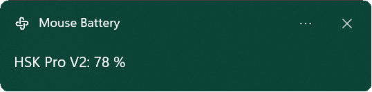
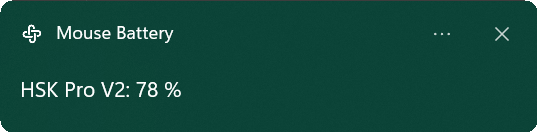
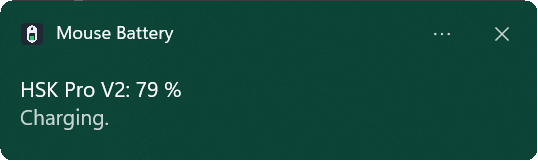
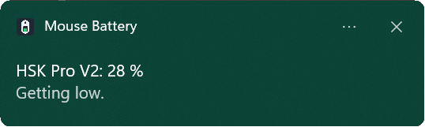
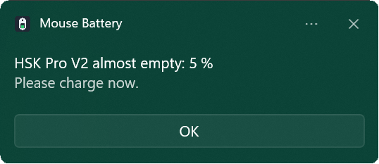

# Mouse Battery

**Akkustand deiner G-Wolves-Maus – ohne extra Software zu öffnen.**

Ein kleines, kostenloses Windows-Hintergrundprogramm – kein Fenster, kein Taskleisten-Symbol, kein Konto, kein Tracking.

[**⬇ Herunterladen**](../../../releases/latest) · [In 1 Minute installiert](#installation) · [💬 Feedback ohne Konto](https://docs.google.com/forms/d/e/1FAIpQLScsMFl2yEgZeK9XnnpdxrZ11qGO5dJ4ZLNxyg6os8Y4bVqsmg/viewform) · [🇬🇧 English](../README.md)

> 💬 **Deine Ideen machen dieses Programm besser.** Dir fehlt etwas, du willst eine andere Warnstufe, oder deine Maus wird nicht erkannt? [Schreib mir kurz – ohne Konto](https://docs.google.com/forms/d/e/1FAIpQLScsMFl2yEgZeK9XnnpdxrZ11qGO5dJ4ZLNxyg6os8Y4bVqsmg/viewform) oder [öffne ein Issue](../../../issues/new/choose) – ich lese alles und baue gern Änderungen ein. Deutsch oder Englisch, ganz ohne GitHub-Erfahrung.

---

## ✨ Was es macht

### 🔋 Eine Meldung statt Konfigurator
Beim Einschalten des PCs sagt dir eine leise Windows-Meldung den Stand: **„HSK Pro V2: 80 %“**. Danach jede Stunde. Mehr nicht – keine Webseite, kein Programmfenster.

### 🎮 Warnungen warten, bis du das Spiel verlässt
Eine Warnung bei wenig Akku kommt nicht in dem Moment, in dem der Akku sinkt. Sie **wartet auf deinen nächsten Fensterwechsel** – Windows-Taste, Alt+Tab oder Klick in ein anderes Fenster. So stört sie nicht, während du zielst; du siehst sie, sobald du das Spiel sowieso verlässt. Nur bei 5 % kommt sie sofort. Auch die normale stündliche Meldung wartet, solange ein Spiel oder Video im Vollbild läuft.

### 📸 Alle Meldungen auf einen Blick

| Meldung | So sieht sie aus | Wann sie kommt |
|---|---|---|
| **PC-Start** |  | Erste Antwort der Maus nach dem PC-Start – sofort, auch im Vollbild. Ohne Ton. |
| **Jede Stunde** |  | Nichts im Vollbild: sofort, ohne Ton. Etwas im Vollbild: wartet auf deinen nächsten Fensterwechsel. |
| **Maus aufgewacht** |  | Eine Stunde ist um, aber die Maus hat geschlafen: sobald du sie bewegst – sofort **mit Ton**, auch im Vollbild. |
| **Lädt** |  | Wie oben, mit einer zweiten Zeile, während die Maus lädt. Beim Laden kommt außerdem **alle 10 %** eine Meldung, ab einem vollen Schritt über dem Einsteck-Stand (bei 18 % → 30, 40 … 100 %). Bei 100 %: „Voll geladen.“ Ohne Ton; wartet im Vollbild auf den nächsten Fensterwechsel. |
| **Voll geladen** | – | Lädt und steht bei 100 %. Ohne Ton. |
| **Jetzt abstecken** | – | Nur im [Akku-Schonmodus](#-akku-schonmodus-optional): bei 80 % beim Laden. Mit Ton, bleibt bis **OK**. |
| **30 %** |  | Beim nächsten Fensterwechsel. Ohne Ton. |
| **15 %** |  | Beim nächsten Fensterwechsel. Mit Ton. |
| **10 % und weniger** |  | Beim nächsten Fensterwechsel. Mit Ton, **bleibt bis du OK klickst**. Unter 10 % jede Minute neu (bei deinen Fensterwechseln). |
| **5 % und weniger** |  | **Sofort, auch im Spiel**, jede Minute. Mit Ton, bleibt bis **OK**. |

Jede neue Meldung ersetzt die vorige derselben Maus, und es wird immer nur die neueste Warnung gezeigt. Sobald du lädst, wird alles zurückgesetzt. Alle Stufen lassen sich in den [Einstellungen](#️-einstellungen) ändern.

> Die Farbe kommt von deiner Windows-Akzentfarbe – siehe [Häufige Fragen](#-häufige-fragen).

> Die Bilder zeigen die englischen Texte; auf deutschem Windows erscheinen die Meldungen auf Deutsch.

### 🔌 Meldungen beim Laden
Steckst du ein, zählt das Programm **in 10-%-Schritten** mit – ab einem vollen Schritt über dem Stand beim Einstecken, damit nicht sofort eine überflüssige Meldung kommt:

- eingesteckt bei **70 %** → 80, 90, 100 %
- eingesteckt bei **18 %** → 30, 40, 50 … 100 %

Bei 100 % steht da **„Voll geladen.“** Alles ohne Ton; läuft ein Spiel im Vollbild, warten die Meldungen bis zum nächsten Fensterwechsel. Schrittweite mit `ChargeStepPercent` änderbar (`0` = aus).

### 👆 Meldung anklicken
- **Frische Meldung** (vor weniger als einer Minute gezeigt) → der offizielle G-Wolves-Webtreiber ([mouse.xyz](https://www.mouse.xyz/)) öffnet sich im Browser.
- **Ältere Meldung** im Mitteilungscenter (<kbd>Win</kbd>+<kbd>N</kbd>) → zuerst kommt eine **frische mit dem aktuellen Stand**. Die anklicken → Webtreiber.

So wird das Mitteilungscenter zum schnellen „Wie voll ist meine Maus gerade?“-Knopf.

### 🌱 Akku-Schonmodus (optional)
Lithium-Akkus altern am schnellsten, wenn sie lange bei **100 %** stehen und wenn sie **fast leer** gefahren werden. Hält man sie etwa zwischen **25 und 80 %**, halten sie spürbar mehr Jahre. Genau das macht der Schonmodus:

| | Normal | Akku-Schonmodus |
|---|---|---|
| Beim Laden | Schritte bis 100 % | Schritte bis 80 %, dann **„Jetzt abstecken – schont den Akku.“** (mit Ton, bleibt bis OK) |
| Erste Warnung | 30 % – ohne Ton | **40 %** – ohne Ton, nur ein Hinweis |
| Mit Ton | 15 % | **30 %** |
| Bleibt bis OK | 10 % | **25 %** – jetzt laden |
| Sofort, auch im Spiel | 5 % | **15 %** |

Die Warnungen bei 40 % und 30 % sind bewusst sanft – du kannst entspannt bis etwa 25 % weiterspielen.

**Einschalten:** `%LOCALAPPDATA%\MouseBattery\config.json` öffnen, `"BatterySaver": true` setzen, dann den PC neu starten (oder *MouseBattery* im Task-Manager beenden und `%LOCALAPPDATA%\Programs\MouseBattery\MouseBattery.exe` starten).

> Das ist eine grobe Schätzung, keine Messung an einem G-Wolves-Akku. Das Programm kann das Laden nicht stoppen – es sagt dir nur, wann du abstecken solltest. Nicht für jeden: Wer nicht darüber nachdenken will, ist mit dem normalen Modus gut bedient.

### 💡 Tipp: ein eigenes Kabel zum Laden
Viele laden, indem sie das Kabel aus dem Empfänger-Dock ziehen, in die Maus stecken – und danach wieder zurück. Macht man das alle paar Tage, leidet der **USB-C-Anschluss am Empfänger-Dock**. Bekommt er einen Wackelkontakt, kann die Funkverbindung mitten im Spiel abbrechen oder stocken.

So mache ich es selbst: Das Empfänger-Kabel **bleibt dauerhaft eingesteckt**, geladen wird mit einem **zweiten USB-C-Kabel** an einem anderen USB-Anschluss. Der Empfänger wird nie bewegt, also kann er keinen Wackelkontakt bekommen.

Das ist meine persönliche Empfehlung – nicht für jeden. Man braucht ein zweites Kabel und einen freien USB-Anschluss, und wer nur ein Kabel auf dem Tisch haben will, kann auch gut umstecken.

### 🖱️ Alle kabellosen G-Wolves-Mäuse, automatisch erkannt
Empfänger (oder Kabel) einstecken – das Programm findet die Maus und nennt sie beim richtigen Namen. Mehrere Mäuse gleichzeitig gehen auch; jede bekommt ihre eigene Meldung.

---

## 🧰 Außerdem
- **Liest** nur den Akkustand. Es sendet nie etwas, das Einstellungen der Maus ändert.
- **Meldung anklicken → der offizielle G-Wolves-Webtreiber ([mouse.xyz](https://www.mouse.xyz/)) öffnet sich im Browser.** Praktisch, um gleich DPI oder Polling-Rate zu ändern. Mit `DriverUrl` in den [Einstellungen](#️-einstellungen) änderbar oder abschaltbar.
- **Läuft komplett offline** – das Programm selbst geht nie ins Internet. Alles, was es braucht, steckt in der `.exe`; nur dein Browser geht online, wenn du eine Meldung anklickst.
- Braucht sehr wenig Arbeitsspeicher und praktisch 0 % Prozessor.
- Deutsch und Englisch – richtet sich nach deiner Windows-Sprache.
- Doppelklick auf das Programm, während es läuft → zeigt sofort den aktuellen Stand.
- Schreibt einen kleinen Verlauf (`history.csv`), damit du siehst, wie lange eine Ladung hält.

## Installation
1. `MouseBattery.exe` [**herunterladen**](../../../releases/latest).
2. Doppelklicken und mit **Ja** bestätigen.
3. Fertig – läuft jetzt im Hintergrund und startet mit Windows.

Keine Admin-Rechte und kein .NET nötig. Windows 10 oder 11 (64 Bit).

> **Windows SmartScreen** warnt eventuell, weil die Datei neu und nicht signiert ist. Klicke auf **Weitere Informationen** → **Trotzdem ausführen**. Der komplette Quellcode liegt hier im Repository, die `.exe` wird von GitHub Actions daraus gebaut.

**Deinstallieren:** *Einstellungen → Apps → Installierte Apps → Mouse Battery → Deinstallieren*.

## 🖱️ Unterstützte Mäuse

### Mit deiner Maus getestet? Sag's mir in 10 Sekunden – ohne Konto: [**👉 Geht / geht nicht**](https://docs.google.com/forms/d/e/1FAIpQLScsMFl2yEgZeK9XnnpdxrZ11qGO5dJ4ZLNxyg6os8Y4bVqsmg/viewform)

Alle G-Wolves-Modelle, die der offizielle Webkonfigurator kennt (Stand November 2026), sind eingebaut. ✅ = von einem echten Nutzer bestätigt. Klick auf ein ❔, um deine zu bestätigen – jede Antwort hilft dem Nächsten.

| Maus | Status |
|---|---|
| Fenrir | [❔ noch nicht bestätigt – getestet?](https://docs.google.com/forms/d/e/1FAIpQLScsMFl2yEgZeK9XnnpdxrZ11qGO5dJ4ZLNxyg6os8Y4bVqsmg/viewform) |
| Fenrir Asym | [❔ noch nicht bestätigt – getestet?](https://docs.google.com/forms/d/e/1FAIpQLScsMFl2yEgZeK9XnnpdxrZ11qGO5dJ4ZLNxyg6os8Y4bVqsmg/viewform) |
| Fenrir Max | [❔ noch nicht bestätigt – getestet?](https://docs.google.com/forms/d/e/1FAIpQLScsMFl2yEgZeK9XnnpdxrZ11qGO5dJ4ZLNxyg6os8Y4bVqsmg/viewform) |
| Fenrir Max Asym | [❔ noch nicht bestätigt – getestet?](https://docs.google.com/forms/d/e/1FAIpQLScsMFl2yEgZeK9XnnpdxrZ11qGO5dJ4ZLNxyg6os8Y4bVqsmg/viewform) |
| **Fenrir Pro** | ✅ bestätigt (Receiver RS) |
| HSK Lite | [❔ noch nicht bestätigt – getestet?](https://docs.google.com/forms/d/e/1FAIpQLScsMFl2yEgZeK9XnnpdxrZ11qGO5dJ4ZLNxyg6os8Y4bVqsmg/viewform) |
| HSK Plus | [❔ noch nicht bestätigt – getestet?](https://docs.google.com/forms/d/e/1FAIpQLScsMFl2yEgZeK9XnnpdxrZ11qGO5dJ4ZLNxyg6os8Y4bVqsmg/viewform) |
| HSK Plus ACE | [❔ noch nicht bestätigt – getestet?](https://docs.google.com/forms/d/e/1FAIpQLScsMFl2yEgZeK9XnnpdxrZ11qGO5dJ4ZLNxyg6os8Y4bVqsmg/viewform) |
| HSK Pro | [❔ noch nicht bestätigt – getestet?](https://docs.google.com/forms/d/e/1FAIpQLScsMFl2yEgZeK9XnnpdxrZ11qGO5dJ4ZLNxyg6os8Y4bVqsmg/viewform) |
| HSK Pro ACE | [❔ noch nicht bestätigt – getestet?](https://docs.google.com/forms/d/e/1FAIpQLScsMFl2yEgZeK9XnnpdxrZ11qGO5dJ4ZLNxyg6os8Y4bVqsmg/viewform) |
| **HSK Pro V2** | ✅ bestätigt |
| HT-S2 | [❔ noch nicht bestätigt – getestet?](https://docs.google.com/forms/d/e/1FAIpQLScsMFl2yEgZeK9XnnpdxrZ11qGO5dJ4ZLNxyg6os8Y4bVqsmg/viewform) |
| HT-S2 Pro | [❔ noch nicht bestätigt – getestet?](https://docs.google.com/forms/d/e/1FAIpQLScsMFl2yEgZeK9XnnpdxrZ11qGO5dJ4ZLNxyg6os8Y4bVqsmg/viewform) |
| HTM Plus | [❔ noch nicht bestätigt – getestet?](https://docs.google.com/forms/d/e/1FAIpQLScsMFl2yEgZeK9XnnpdxrZ11qGO5dJ4ZLNxyg6os8Y4bVqsmg/viewform) |
| HTR | [❔ noch nicht bestätigt – getestet?](https://docs.google.com/forms/d/e/1FAIpQLScsMFl2yEgZeK9XnnpdxrZ11qGO5dJ4ZLNxyg6os8Y4bVqsmg/viewform) |
| HTR Pro | [❔ noch nicht bestätigt – getestet?](https://docs.google.com/forms/d/e/1FAIpQLScsMFl2yEgZeK9XnnpdxrZ11qGO5dJ4ZLNxyg6os8Y4bVqsmg/viewform) |
| HTS Plus | [❔ noch nicht bestätigt – getestet?](https://docs.google.com/forms/d/e/1FAIpQLScsMFl2yEgZeK9XnnpdxrZ11qGO5dJ4ZLNxyg6os8Y4bVqsmg/viewform) |
| HTS Plus ACE | [❔ noch nicht bestätigt – getestet?](https://docs.google.com/forms/d/e/1FAIpQLScsMFl2yEgZeK9XnnpdxrZ11qGO5dJ4ZLNxyg6os8Y4bVqsmg/viewform) |
| HTS Plus Pro | [❔ noch nicht bestätigt – getestet?](https://docs.google.com/forms/d/e/1FAIpQLScsMFl2yEgZeK9XnnpdxrZ11qGO5dJ4ZLNxyg6os8Y4bVqsmg/viewform) |
| HTS Ultra | [❔ noch nicht bestätigt – getestet?](https://docs.google.com/forms/d/e/1FAIpQLScsMFl2yEgZeK9XnnpdxrZ11qGO5dJ4ZLNxyg6os8Y4bVqsmg/viewform) |
| HTX | [❔ noch nicht bestätigt – getestet?](https://docs.google.com/forms/d/e/1FAIpQLScsMFl2yEgZeK9XnnpdxrZ11qGO5dJ4ZLNxyg6os8Y4bVqsmg/viewform) |
| HTX ACE | [❔ noch nicht bestätigt – getestet?](https://docs.google.com/forms/d/e/1FAIpQLScsMFl2yEgZeK9XnnpdxrZ11qGO5dJ4ZLNxyg6os8Y4bVqsmg/viewform) |
| HTX Mini | [❔ noch nicht bestätigt – getestet?](https://docs.google.com/forms/d/e/1FAIpQLScsMFl2yEgZeK9XnnpdxrZ11qGO5dJ4ZLNxyg6os8Y4bVqsmg/viewform) |
| HTX Mini Asym | [❔ noch nicht bestätigt – getestet?](https://docs.google.com/forms/d/e/1FAIpQLScsMFl2yEgZeK9XnnpdxrZ11qGO5dJ4ZLNxyg6os8Y4bVqsmg/viewform) |
| HTXU | [❔ noch nicht bestätigt – getestet?](https://docs.google.com/forms/d/e/1FAIpQLScsMFl2yEgZeK9XnnpdxrZ11qGO5dJ4ZLNxyg6os8Y4bVqsmg/viewform) |
| Lycan | [❔ noch nicht bestätigt – getestet?](https://docs.google.com/forms/d/e/1FAIpQLScsMFl2yEgZeK9XnnpdxrZ11qGO5dJ4ZLNxyg6os8Y4bVqsmg/viewform) |
| VUK | [❔ noch nicht bestätigt – getestet?](https://docs.google.com/forms/d/e/1FAIpQLScsMFl2yEgZeK9XnnpdxrZ11qGO5dJ4ZLNxyg6os8Y4bVqsmg/viewform) |
| VUK Mini | [❔ noch nicht bestätigt – getestet?](https://docs.google.com/forms/d/e/1FAIpQLScsMFl2yEgZeK9XnnpdxrZ11qGO5dJ4ZLNxyg6os8Y4bVqsmg/viewform) |
| WARG | [❔ noch nicht bestätigt – getestet?](https://docs.google.com/forms/d/e/1FAIpQLScsMFl2yEgZeK9XnnpdxrZ11qGO5dJ4ZLNxyg6os8Y4bVqsmg/viewform) |

Geht nicht, oder deine Maus fehlt? Nutze [dasselbe Formular](https://docs.google.com/forms/d/e/1FAIpQLScsMFl2yEgZeK9XnnpdxrZ11qGO5dJ4ZLNxyg6os8Y4bVqsmg/viewform) oder [öffne ein Issue](../../../issues/new/choose) – eine neue Maus ist oft nur eine Zeile Code.

## ⚙️ Einstellungen
Die Einstellungen stehen in `%LOCALAPPDATA%\MouseBattery\config.json` (in die Adresszeile des Explorers einfügen). Wert ändern, dann das Programm neu starten (oder ab- und wieder anmelden).

| Einstellung | Standard | Bedeutung |
|---|---|---|
| `Language` | `auto` | `auto`, `en` oder `de` |
| `InfoEveryHours` | `1` | wie oft die normale Meldung kommt |
| `FirstWarningPercent` | `30` | leise Warnung |
| `SecondWarningPercent` | `15` | Warnung mit Ton |
| `ThirdWarningPercent` | `10` | Warnung bleibt bis **OK** |
| `ImmediatePercent` | `5` | Warnung sofort, auch im Spiel |
| `RepeatSeconds` | `60` | Wiederholung unter 10 % |
| `CheckIntervalSeconds` | `10` | wie oft der Akku gelesen wird |
| `WarningSound` | `""` | eigene `.wav` (optional) für Meldungen mit Ton (Aufwachen, 15 %) |
| `UrgentSound` | `""` | eigene `.wav` (optional) für dringende Warnungen (10 % und weniger) |
| `DriverUrl` | `"https://www.mouse.xyz/"` | Seite, die sich beim Klick auf eine frische Meldung öffnet; `""` = nie eine Seite öffnen |
| `FreshSeconds` | `60` | Meldung jünger als das öffnet beim Klick `DriverUrl`; eine ältere zeigt stattdessen eine frische Meldung |
| `ChargeStepPercent` | `10` | beim Laden eine Meldung alle so viele Prozent; `0` = aus |
| `ChargeLimitPercent` | `0` | beim Laden „Jetzt abstecken“ bei diesem Stand; `0` = aus (bis 100 % laden) |
| `BatterySaver` | `false` | `true` = [Akku-Schonmodus](#-akku-schonmodus-optional): Ladegrenze 80 %, Warnungen bei 40 / 30 / 25 %, sofort bei 15 % |
| `MouseNames` | `{}` | eigene Namen, z. B. `{ "5817": "Meine HSK" }` (Produkt-ID aus `log.txt`) |

## ❓ Häufige Fragen

**Ich bekomme keine Meldung.**
Prüfe unter *Einstellungen → System → Benachrichtigungen*, ob *Mouse Battery* eingeschaltet und *Nicht stören* aus ist. Das Protokoll liegt in `%LOCALAPPDATA%\MouseBattery\log.txt`.

**Warum ist die Meldung auf den Bildern grün?**
Windows färbt Meldungen in deiner **Akzentfarbe**. Die Bilder sind nur grün, weil die Akzentfarbe des Entwicklers grün ist – bei dir erscheinen sie in deiner eigenen Farbe (*Einstellungen → Personalisierung → Farben*).

**Ich höre keinen Ton.**
Das Programm hat keinen eigenen Ton – es nutzt den Windows-Meldungston aus deinem Soundschema (*Benachrichtigung*, bei Meldungen mit **OK**-Knopf *Erinnerung*). Hast du dort eine eigene `.wav`-Datei eingestellt, die **außerhalb von `C:\Windows\Media`** liegt, bleiben Meldungen still: Der Meldungsdienst von Windows darf solche Dateien nicht lesen. Das betrifft alle Programme, nicht nur dieses. Abhilfe: die `.wav` nach `C:\Windows\Media` kopieren und im Soundschema neu auswählen (*Systemsteuerung → Sound → Sounds*).

**Ich habe alle Meldungstöne stummgeschaltet, will aber für meine Maus trotzdem einen Ton.**
Trag in den [Einstellungen](#️-einstellungen) `WarningSound` und/oder `UrgentSound` mit einer `.wav`-Datei ein, z. B. `"UrgentSound": "C:\\Windows\\Media\\Alarm01.wav"` (doppelte Backslashes). Dann bleibt die Meldung selbst still, und das Programm spielt deine Datei ab – auch wenn alle Windows-Meldungstöne aus sind. Leer lassen = normaler Windows-Ton. Leise Meldungen (PC-Start, 30 %) bleiben leise.

**Es heißt, die Maus schläft.**
G-Wolves-Mäuse schlafen nach kurzer Pause und können dann nicht antworten. Maus bewegen – der Stand kommt, sobald sie wach ist.

**Kann es meine Maus kaputt machen oder Einstellungen ändern?**
Nein. Es sendet nur dieselbe *Akku lesen*-Anfrage wie der offizielle Webkonfigurator. Keine Einstellungen, keine Firmware.

**Geht es zusammen mit dem offiziellen Konfigurator?**
Ja. Fragen beide im selben Moment, fällt höchstens eine Messung aus.

**Ist das ein Anti-Cheat-Risiko?**
Es liest keine Tasten mit, greift nicht in Spiele ein und hängt sich nicht in die Eingabe. Es merkt nur, *dass* das Vordergrundfenster wechselt (ein normales Windows-Ereignis).

**Warum ist die .exe 11 MB groß?**
Sie enthält .NET, damit du nichts installieren musst.

## 🙏 Danke
Die Akku-Protokolle wurden durch Lesen dieser Projekte verstanden – danke! Es wurde kein Code kopiert.
- [quenTiago/windows-taskbar-battery](https://github.com/quenTiago/windows-taskbar-battery)
- [maximelonguepe/gwolves-battery-overlay](https://github.com/maximelonguepe/gwolves-battery-overlay) (Protokoll-Beschreibung)
- Die Modellliste stammt aus der Geräteliste, die der öffentliche G-Wolves-Webkonfigurator im Browser lädt.

## ⚠️ Hinweis
Das ist ein **inoffizielles** Community-Projekt. Es ist **nicht von G-Wolves** und wird von G-Wolves weder unterstützt noch empfohlen. „G-Wolves“, das G-Wolves-Logo und die Modellnamen sind Marken ihres Inhabers. Sie werden nur genannt, um zu sagen, welche Mäuse unterstützt werden, und das Logo erscheint nur in den Meldungen, damit man auf einen Blick sieht, um welche Maus es geht. Nutzung auf eigene Gefahr.

## 🗺️ Ideen für später
Noch nicht eingebaut – nur Pläne. Sag mir, was du zuerst sehen willst ([ohne Konto](https://docs.google.com/forms/d/e/1FAIpQLScsMFl2yEgZeK9XnnpdxrZ11qGO5dJ4ZLNxyg6os8Y4bVqsmg/viewform) oder [Issue](../../../issues/new/choose)).

- **Konfigurator auswählen.** Ein Klick auf eine Meldung öffnet schon mouse.xyz (seit 1.1.0). Nächster Schritt: eine kleine Seite im Browser, auf der du auswählst, welcher offizielle G-Wolves-Webkonfigurator starten soll (es gibt mehrere). Das Programm selbst ginge weiterhin nie ins Internet.

## 💬 Fragen & Ideen
**Dieses Projekt lebt von deinen Rückmeldungen.** Fehler, neue Maus, ein Wunsch oder einfach „wäre schön, wenn…“? [Issue öffnen](../../../issues/new/choose) – jeder Vorschlag wird gelesen, und ich baue gern ein, was du brauchst. Auch Kleinigkeiten wie ein anderer Text oder Ton sind willkommen. Pull Requests auch, siehe [CONTRIBUTING](../CONTRIBUTING.md). Wenn es dir hilft, freut sich das Projekt über einen ⭐.

## Wie es entstanden ist
Geplant und getestet vom Betreuer, geschrieben mit Hilfe von **Claude**, dem KI-Assistenten von Anthropic.

## Lizenz
MIT – siehe [LICENSE](../LICENSE).
