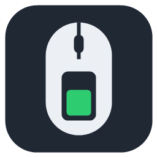

# Mouse Battery

**Akkustand deiner G-Wolves-Maus – ohne extra Software zu öffnen.**

Ein kleines, kostenloses Windows-Hintergrundprogramm – kein Fenster, kein Taskleisten-Symbol, kein Konto, kein Tracking.

[**⬇ Herunterladen**](../../../releases/latest) · [In 1 Minute installiert](#installation) · [💬 Vorschlag machen](../../../issues/new/choose) · [🇬🇧 English](../README.md)

> 💬 **Deine Ideen machen dieses Programm besser.** Dir fehlt etwas, du willst eine andere Warnstufe, oder deine Maus wird nicht erkannt? [Schreib ein Issue](../../../issues/new/choose) oder einen Kommentar – ich lese alles und baue gern Änderungen ein. Deutsch oder Englisch, ganz ohne GitHub-Erfahrung.

---

## ✨ Was es macht

### 🔋 Eine Meldung statt Konfigurator
Beim Einschalten des PCs sagt dir eine leise Windows-Meldung den Stand: **„HSK Pro V2: 82 %“**. Danach alle 3 Stunden. Mehr nicht – keine Webseite, kein Programmfenster.

> 📸 *Screenshot folgt.*

### 🎮 Nie mitten im Spiel
Warnungen bei wenig Akku **warten, bis du das Fenster wechselst** (Windows-Taste, Alt+Tab, Klick in ein anderes Fenster). So kommt nie eine Warnung, während du zielst – du siehst sie, sobald du das Spiel sowieso verlässt.

| Akku | Was passiert |
|---|---|
| **30 %** | leise Meldung |
| **15 %** | Meldung mit Ton |
| **10 %** | mit Ton, bleibt bis du **OK** klickst |
| **unter 10 %** | wie 10 %, jede Minute neu |
| **5 % und weniger** | **sofort**, egal was du machst, jede Minute |

Sobald du lädst, wird alles zurückgesetzt.

### 🖱️ Alle kabellosen G-Wolves-Mäuse, automatisch erkannt
Empfänger (oder Kabel) einstecken – das Programm findet die Maus und nennt sie beim richtigen Namen. Mehrere Mäuse gleichzeitig gehen auch; jede bekommt ihre eigene Meldung.

---

## 🧰 Außerdem
- **Liest** nur den Akkustand. Es sendet nie etwas, das Einstellungen der Maus ändert.
- Braucht sehr wenig Arbeitsspeicher und praktisch 0 % Prozessor.
- Deutsch und Englisch – richtet sich nach deiner Windows-Sprache.
- Doppelklick auf das Programm, während es läuft → zeigt sofort den aktuellen Stand.
- Schreibt einen kleinen Verlauf (`history.csv`), damit du siehst, wie lange eine Ladung hält.

## Installation
1. `MouseBattery.exe` [**herunterladen**](../../../releases/latest).
2. Doppelklicken und mit **Ja** bestätigen.
3. Fertig – läuft jetzt im Hintergrund und startet mit Windows.

Keine Admin-Rechte und kein .NET nötig. Windows 10 oder 11 (64 Bit).

> **Windows SmartScreen** warnt eventuell, weil die Datei neu und nicht signiert ist. Klicke auf **Weitere Informationen** → **Trotzdem ausführen**. Der komplette Quellcode liegt hier im Repository, die `.exe` wird von GitHub Actions daraus gebaut.

**Deinstallieren:** *Einstellungen → Apps → Installierte Apps → Mouse Battery → Deinstallieren*.

## 🖱️ Unterstützte Mäuse

Alle Modelle, die der offizielle G-Wolves-Webkonfigurator kennt (Stand November 2026):

| Protokoll | Modelle |
|---|---|
| Neuer | HSK Pro V2, HTM Plus, HTXU, Fenrir Pro |
| Älter | HSK Pro, HSK Plus, HSK Lite, HTS Plus, HTS Ultra, HTX, HTX Mini, HTR, HTR Pro, HT-S2, HT-S2 Pro, Fenrir, Fenrir Max, VUK, HSK Pro ACE, HSK Plus ACE, HTS Plus ACE, HTX ACE |
| „Receiver RS“ | Fenrir Pro, Fenrir Asym, Fenrir Max Asym, HTS Plus, HTS Plus Pro, HTXU, HTX Mini, HTX Mini Asym, Lycan, WARG, VUK Mini |

**Bisher getestet:** HSK Pro V2 und Fenrir Pro (Receiver RS). Die anderen nutzen dieselben Protokolle und sollten funktionieren – wenn deine nicht geht (oder geht!), [sag gern Bescheid](../../../issues/new/choose). Eine neue Maus ist oft nur eine Zeile Code.

## ⚙️ Einstellungen
Die Einstellungen stehen in `%LOCALAPPDATA%\MouseBattery\config.json` (in die Adresszeile des Explorers einfügen). Wert ändern, dann das Programm neu starten (oder ab- und wieder anmelden).

| Einstellung | Standard | Bedeutung |
|---|---|---|
| `Language` | `auto` | `auto`, `en` oder `de` |
| `InfoEveryHours` | `3` | wie oft die normale Meldung kommt |
| `FirstWarningPercent` | `30` | leise Warnung |
| `SecondWarningPercent` | `15` | Warnung mit Ton |
| `ThirdWarningPercent` | `10` | Warnung bleibt bis **OK** |
| `ImmediatePercent` | `5` | Warnung sofort, auch im Spiel |
| `RepeatSeconds` | `60` | Wiederholung unter 10 % |
| `CheckIntervalSeconds` | `10` | wie oft der Akku gelesen wird |
| `MouseNames` | `{}` | eigene Namen, z. B. `{ "5817": "Meine HSK" }` (Produkt-ID aus `log.txt`) |

## ❓ Häufige Fragen

**Ich bekomme keine Meldung.**
Prüfe unter *Einstellungen → System → Benachrichtigungen*, ob *Mouse Battery* eingeschaltet und *Nicht stören* aus ist. Das Protokoll liegt in `%LOCALAPPDATA%\MouseBattery\log.txt`.

**Es heißt, die Maus schläft.**
G-Wolves-Mäuse schlafen nach kurzer Pause und können dann nicht antworten. Maus bewegen – der Stand kommt, sobald sie wach ist.

**Kann es meine Maus kaputt machen oder Einstellungen ändern?**
Nein. Es sendet nur dieselbe *Akku lesen*-Anfrage wie der offizielle Webkonfigurator. Keine Einstellungen, keine Firmware.

**Geht es zusammen mit dem offiziellen Konfigurator?**
Ja. Fragen beide im selben Moment, fällt höchstens eine Messung aus.

**Ist das ein Anti-Cheat-Risiko?**
Es liest keine Tasten mit, greift nicht in Spiele ein und hängt sich nicht in die Eingabe. Es merkt nur, *dass* das Vordergrundfenster wechselt (ein normales Windows-Ereignis).

**Warum ist die .exe 11 MB groß?**
Sie enthält .NET, damit du nichts installieren musst.

## 🙏 Danke
Die Akku-Protokolle wurden durch Lesen dieser Projekte verstanden – danke! Es wurde kein Code kopiert.
- [quenTiago/windows-taskbar-battery](https://github.com/quenTiago/windows-taskbar-battery)
- [maximelonguepe/gwolves-battery-overlay](https://github.com/maximelonguepe/gwolves-battery-overlay) (Protokoll-Beschreibung)
- Die Modellliste stammt aus der Geräteliste, die der öffentliche G-Wolves-Webkonfigurator im Browser lädt.

## ⚠️ Hinweis
Das ist ein **inoffizielles** Community-Projekt. Es ist **nicht von G-Wolves** und wird von G-Wolves weder unterstützt noch empfohlen. „G-Wolves“ und die Modellnamen sind Marken ihres Inhabers und werden nur genannt, um zu sagen, welche Mäuse unterstützt werden. Nutzung auf eigene Gefahr.

## 💬 Fragen & Ideen
**Dieses Projekt lebt von deinen Rückmeldungen.** Fehler, neue Maus, ein Wunsch oder einfach „wäre schön, wenn…“? [Issue öffnen](../../../issues/new/choose) – jeder Vorschlag wird gelesen, und ich baue gern ein, was du brauchst. Auch Kleinigkeiten wie ein anderer Text oder Ton sind willkommen. Pull Requests auch, siehe [CONTRIBUTING](../CONTRIBUTING.md). Wenn es dir hilft, freut sich das Projekt über einen ⭐.

## Wie es entstanden ist
Geplant und getestet vom Betreuer, geschrieben mit Hilfe von **Claude**, dem KI-Assistenten von Anthropic.

## Lizenz
MIT – siehe [LICENSE](../LICENSE).
