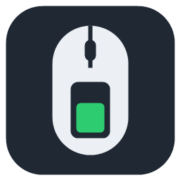
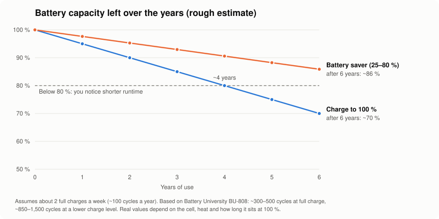
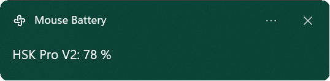
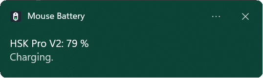
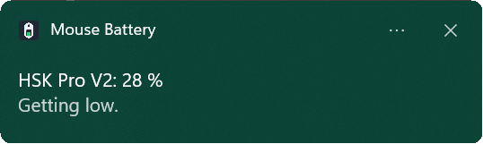
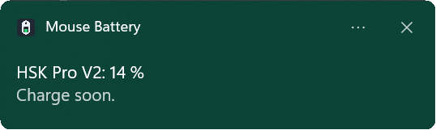
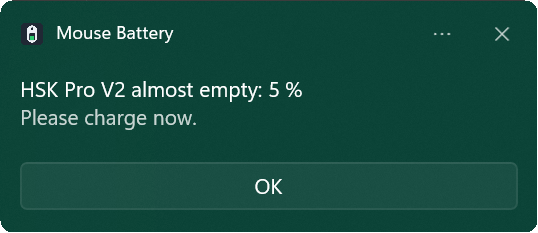

# Mouse Battery

**Know your G-Wolves battery level – without opening any software.**

A tiny, free Windows background app. No window, no tray icon, no account, no tracking.
One short setup the first time – then it just works.

[**⬇ Download**](../../releases/latest) · [Install in 1 minute](#-install) · [💬 Feedback without account](https://docs.google.com/forms/d/e/1FAIpQLScsMFl2yEgZeK9XnnpdxrZ11qGO5dJ4ZLNxyg6os8Y4bVqsmg/viewform) · [🇩🇪 Deutsch](German-Version/README.md)

> 💬 **Your ideas shape this app.** Missing a feature, want a different warning level, or your mouse isn't recognized? [Leave a quick note – no account needed](https://docs.google.com/forms/d/e/1FAIpQLScsMFl2yEgZeK9XnnpdxrZ11qGO5dJ4ZLNxyg6os8Y4bVqsmg/viewform) or [open an issue](../../issues/new/choose) – I read everything and I'm happy to make changes. English or German, no GitHub experience needed.

---

## ✨ Highlights

### 🎬 One-time demo and setup – then nothing is left over
Right after installing, the app shows you a **30-second demo** in three notifications: what your battery level looks like, what a warning looks like – and one question:

> **Save your battery?** &nbsp; `Yes` · `No`

- **Yes** → [battery saver mode](#-battery-saver-mode) is on. You get a short explanation of how it works and the tip about a [separate charging cable](#-tip-use-a-separate-cable-for-charging).
- **No** → the app simply runs normally.

That's the only question, and it's **asked only once**. After that the setup is gone: no settings window, no switches, no leftover setup files – the app stays as small as possible. **Changed your mind?** Uninstall and install again (takes a minute) – the demo and the question come once more.

### 🎮 Warnings wait until you leave your game
A low-battery warning is not shown the moment the level drops. It **waits for your next window switch** – Windows key, Alt+Tab, or clicking another window. So it never pops up while you're aiming; you see it the next time you leave the game anyway. Only when the battery is really empty does it come right away. The regular hourly notification also waits while a game or video runs in fullscreen.

### 👆 Click a notification
- **The first time:** you pick which official G-Wolves page should open – **Web driver** ([mouse.xyz](https://www.mouse.xyz/), the official "G-Wolves Mouse Web Driver"), **Downloads** (official software and firmware page) or **Shop**. Your choice is saved.
- **From then on:** a click on a fresh notification opens your page **automatically** – handy for changing DPI or polling rate right away.
- **The notification doesn't get lost:** after your page opens, a fresh one with the current level goes quietly into the notification center (no pop-up). So there's always one waiting there to click.
- **Hold <kbd>Ctrl</kbd> while clicking** → the choice of pages comes back. Useful if a page is ever shut down or moves. That's the only way to change it – and the only option there is.
- **Older notification** in the notification center (<kbd>Win</kbd>+<kbd>N</kbd>) → you first get a **fresh one with the current level**. Click that one → your page. So the notification center doubles as a quick "what's my battery right now?" button.

The app itself never goes online – only your browser does, when you click.

### 🔌 Notifications while charging
Plug in and the app counts along **in 10 % steps** – starting one full step above where you plugged in, so you never get a notification right away for nothing:

- plugged in at **70 %** → 80, 90, 100 %
- plugged in at **18 %** → 30, 40, 50 … 100 %

At 100 % it says **"Fully charged."** All silent; while a game runs in fullscreen they wait for your next window switch.

### 🌱 Battery saver mode
Lithium batteries age fastest when they sit at **100 %** and when they are run **almost empty**. Keeping them between about **25 and 80 %** makes them last noticeably more years. If you answer **Yes** in the setup, the app helps you do exactly that:

| | Normal | Battery saver |
|---|---|---|
| While charging | steps up to 100 % | steps up to 80 %, then **"Unplug now – saves the battery."** (with sound, stays until OK) |
| First warning | 30 % – silent | **40 %** – silent, just a heads-up |
| With sound | 15 % | **30 %** |
| Stays until OK | 10 % | **25 %** – time to charge |
| Right away, even in a game | 5 % | **15 %** |

The 40 % and 30 % warnings are gentle on purpose – you can keep playing comfortably until about 25 %.

> This is a rough estimate, not a measurement of a G-Wolves battery. The app can't stop the mouse from charging – it only tells you when to unplug. Not for everyone: if you'd rather never think about it, answer **No** and the normal mode is fine.

### 💡 Tip: use a separate cable for charging
Many people charge by pulling the cable out of the receiver dock and plugging it into the mouse – and back again afterwards. Doing that every few days wears out the **USB-C port of the receiver dock**. Once it gets a loose contact, the wireless connection can drop out or stutter mid-game.

What I do myself: the receiver cable **stays plugged in for good**, and I charge with a **second USB-C cable** from another USB port. The receiver never moves, so it can't get a loose contact.

That's my personal recommendation – it's not for everyone. You need a second cable and a free USB port, and if you prefer just one cable on your desk, swapping is perfectly fine too.

### 🖱️ All G-Wolves wireless mice, recognized automatically
Plug in the receiver (or the cable) – the app finds the mouse and uses its real name. Several mice at the same time work too; each gets its own notification.

---

## 📸 Every notification at a glance

| Notification | Looks like | When it comes |
|---|---|---|
| **PC start** |  | First answer of the mouse after the PC starts – right away, even in fullscreen. Silent. |
| **Every hour** |  | Nothing in fullscreen: right away, silent. Something in fullscreen: waits for your next window switch. |
| **Mouse woke up** |  | An hour is over but the mouse was asleep: the moment you move it – right away **with sound**, even in fullscreen. |
| **Charging** |  | Every 10 % while charging (see above), with "Charging." as second line. Silent. |
| **Fully charged** | – | Charging and at 100 %. Silent. |
| **Unplug now** | – | Battery saver only: at 80 % while charging. With sound, stays until **OK**. |
| **30 %** (saver: 40 %) |  | At your next window switch. Silent. |
| **15 %** (saver: 30 %) |  | At your next window switch. With sound. |
| **10 %** (saver: 25 %) and below |  | At your next window switch. With sound, **stays until you click OK**. Below that it comes again every minute (at your window switches). |
| **5 %** (saver: 15 %) and below |  | **Right away, even in a game**, every minute. With sound, stays until **OK**. |

Each new notification replaces the previous one of the same mouse, and only the newest warning is shown. All warnings reset as soon as you charge.

> The color comes from your Windows accent color – see the [FAQ](#-faq).

## 🧰 Everything else
- Only **reads** the battery level. It never sends anything that changes your mouse settings.
- **Works completely offline** – everything it needs is inside the `.exe`.
- Uses very little memory and practically 0 % CPU.
- English and German – follows your Windows language.
- Double-click the app while it's running → shows the current level right away.
- Writes a small history (`history.csv`) so you can see how long a charge lasts.

## 📥 Install
1. [**Download**](../../releases/latest) `MouseBattery.exe` – always the newest version.
2. Double-click it and answer **Yes**.
3. Watch the short demo and answer the battery saver question. Done – it runs in the background and starts with Windows.

No admin rights and no .NET installation needed. Windows 10 or 11 (64-bit).

> **Windows SmartScreen** may warn you because the file is new and not signed. Click **More info** → **Run anyway**. The full source code is in this repository, and the `.exe` is built by GitHub Actions from it.

**Update:** download the new `MouseBattery.exe` and double-click it – it replaces the old one and keeps your answers.
**Uninstall:** *Settings → Apps → Installed apps → Mouse Battery → Uninstall*. This removes everything, including your answers.

## 🖱️ Supported mice

### Tested it with your mouse? Tell me in 10 seconds – no account: [**👉 Works / doesn't work**](https://docs.google.com/forms/d/e/1FAIpQLScsMFl2yEgZeK9XnnpdxrZ11qGO5dJ4ZLNxyg6os8Y4bVqsmg/viewform)

Every G-Wolves model the official web configurator knows (as of November 2026) is built in. ✅ = confirmed by a real user. Click a ❔ to confirm yours – every answer helps the next person.

| Mouse | Status |
|---|---|
| Fenrir | [❔ not confirmed yet – tested it?](https://docs.google.com/forms/d/e/1FAIpQLScsMFl2yEgZeK9XnnpdxrZ11qGO5dJ4ZLNxyg6os8Y4bVqsmg/viewform) |
| Fenrir Asym | [❔ not confirmed yet – tested it?](https://docs.google.com/forms/d/e/1FAIpQLScsMFl2yEgZeK9XnnpdxrZ11qGO5dJ4ZLNxyg6os8Y4bVqsmg/viewform) |
| Fenrir Max | [❔ not confirmed yet – tested it?](https://docs.google.com/forms/d/e/1FAIpQLScsMFl2yEgZeK9XnnpdxrZ11qGO5dJ4ZLNxyg6os8Y4bVqsmg/viewform) |
| Fenrir Max Asym | [❔ not confirmed yet – tested it?](https://docs.google.com/forms/d/e/1FAIpQLScsMFl2yEgZeK9XnnpdxrZ11qGO5dJ4ZLNxyg6os8Y4bVqsmg/viewform) |
| **Fenrir Pro** | ✅ confirmed (Receiver RS) |
| HSK Lite | [❔ not confirmed yet – tested it?](https://docs.google.com/forms/d/e/1FAIpQLScsMFl2yEgZeK9XnnpdxrZ11qGO5dJ4ZLNxyg6os8Y4bVqsmg/viewform) |
| HSK Plus | [❔ not confirmed yet – tested it?](https://docs.google.com/forms/d/e/1FAIpQLScsMFl2yEgZeK9XnnpdxrZ11qGO5dJ4ZLNxyg6os8Y4bVqsmg/viewform) |
| HSK Plus ACE | [❔ not confirmed yet – tested it?](https://docs.google.com/forms/d/e/1FAIpQLScsMFl2yEgZeK9XnnpdxrZ11qGO5dJ4ZLNxyg6os8Y4bVqsmg/viewform) |
| HSK Pro | [❔ not confirmed yet – tested it?](https://docs.google.com/forms/d/e/1FAIpQLScsMFl2yEgZeK9XnnpdxrZ11qGO5dJ4ZLNxyg6os8Y4bVqsmg/viewform) |
| HSK Pro ACE | [❔ not confirmed yet – tested it?](https://docs.google.com/forms/d/e/1FAIpQLScsMFl2yEgZeK9XnnpdxrZ11qGO5dJ4ZLNxyg6os8Y4bVqsmg/viewform) |
| **HSK Pro V2** | ✅ confirmed |
| HT-S2 | [❔ not confirmed yet – tested it?](https://docs.google.com/forms/d/e/1FAIpQLScsMFl2yEgZeK9XnnpdxrZ11qGO5dJ4ZLNxyg6os8Y4bVqsmg/viewform) |
| HT-S2 Pro | [❔ not confirmed yet – tested it?](https://docs.google.com/forms/d/e/1FAIpQLScsMFl2yEgZeK9XnnpdxrZ11qGO5dJ4ZLNxyg6os8Y4bVqsmg/viewform) |
| HTM Plus | [❔ not confirmed yet – tested it?](https://docs.google.com/forms/d/e/1FAIpQLScsMFl2yEgZeK9XnnpdxrZ11qGO5dJ4ZLNxyg6os8Y4bVqsmg/viewform) |
| HTR | [❔ not confirmed yet – tested it?](https://docs.google.com/forms/d/e/1FAIpQLScsMFl2yEgZeK9XnnpdxrZ11qGO5dJ4ZLNxyg6os8Y4bVqsmg/viewform) |
| HTR Pro | [❔ not confirmed yet – tested it?](https://docs.google.com/forms/d/e/1FAIpQLScsMFl2yEgZeK9XnnpdxrZ11qGO5dJ4ZLNxyg6os8Y4bVqsmg/viewform) |
| HTS Plus | [❔ not confirmed yet – tested it?](https://docs.google.com/forms/d/e/1FAIpQLScsMFl2yEgZeK9XnnpdxrZ11qGO5dJ4ZLNxyg6os8Y4bVqsmg/viewform) |
| HTS Plus ACE | [❔ not confirmed yet – tested it?](https://docs.google.com/forms/d/e/1FAIpQLScsMFl2yEgZeK9XnnpdxrZ11qGO5dJ4ZLNxyg6os8Y4bVqsmg/viewform) |
| HTS Plus Pro | [❔ not confirmed yet – tested it?](https://docs.google.com/forms/d/e/1FAIpQLScsMFl2yEgZeK9XnnpdxrZ11qGO5dJ4ZLNxyg6os8Y4bVqsmg/viewform) |
| HTS Ultra | [❔ not confirmed yet – tested it?](https://docs.google.com/forms/d/e/1FAIpQLScsMFl2yEgZeK9XnnpdxrZ11qGO5dJ4ZLNxyg6os8Y4bVqsmg/viewform) |
| HTX | [❔ not confirmed yet – tested it?](https://docs.google.com/forms/d/e/1FAIpQLScsMFl2yEgZeK9XnnpdxrZ11qGO5dJ4ZLNxyg6os8Y4bVqsmg/viewform) |
| HTX ACE | [❔ not confirmed yet – tested it?](https://docs.google.com/forms/d/e/1FAIpQLScsMFl2yEgZeK9XnnpdxrZ11qGO5dJ4ZLNxyg6os8Y4bVqsmg/viewform) |
| HTX Mini | [❔ not confirmed yet – tested it?](https://docs.google.com/forms/d/e/1FAIpQLScsMFl2yEgZeK9XnnpdxrZ11qGO5dJ4ZLNxyg6os8Y4bVqsmg/viewform) |
| HTX Mini Asym | [❔ not confirmed yet – tested it?](https://docs.google.com/forms/d/e/1FAIpQLScsMFl2yEgZeK9XnnpdxrZ11qGO5dJ4ZLNxyg6os8Y4bVqsmg/viewform) |
| HTXU | [❔ not confirmed yet – tested it?](https://docs.google.com/forms/d/e/1FAIpQLScsMFl2yEgZeK9XnnpdxrZ11qGO5dJ4ZLNxyg6os8Y4bVqsmg/viewform) |
| Lycan | [❔ not confirmed yet – tested it?](https://docs.google.com/forms/d/e/1FAIpQLScsMFl2yEgZeK9XnnpdxrZ11qGO5dJ4ZLNxyg6os8Y4bVqsmg/viewform) |
| VUK | [❔ not confirmed yet – tested it?](https://docs.google.com/forms/d/e/1FAIpQLScsMFl2yEgZeK9XnnpdxrZ11qGO5dJ4ZLNxyg6os8Y4bVqsmg/viewform) |
| VUK Mini | [❔ not confirmed yet – tested it?](https://docs.google.com/forms/d/e/1FAIpQLScsMFl2yEgZeK9XnnpdxrZ11qGO5dJ4ZLNxyg6os8Y4bVqsmg/viewform) |
| WARG | [❔ not confirmed yet – tested it?](https://docs.google.com/forms/d/e/1FAIpQLScsMFl2yEgZeK9XnnpdxrZ11qGO5dJ4ZLNxyg6os8Y4bVqsmg/viewform) |

Not working, or your mouse is missing? Use [the same form](https://docs.google.com/forms/d/e/1FAIpQLScsMFl2yEgZeK9XnnpdxrZ11qGO5dJ4ZLNxyg6os8Y4bVqsmg/viewform) or [open an issue](../../issues/new/choose) – a new mouse is often only one line of code.

## ⚙️ Advanced settings (optional)
You don't need this – the one-time setup covers everything. For tinkerers: `%LOCALAPPDATA%\MouseBattery\config.json` (paste that into the Explorer address bar) holds your setup answers, and you can add any of these values yourself. Then restart the app (or sign out and back in). Your setup answers themselves (battery saver, page) are changed by reinstalling, or the page with <kbd>Ctrl</kbd>+click.

All values

| Setting | Default | Meaning |
|---|---|---|
| `Language` | `auto` | `auto`, `en` or `de` |
| `InfoEveryHours` | `1` | how often the normal level notification comes |
| `FirstWarningPercent` | `30` | silent warning |
| `SecondWarningPercent` | `15` | warning with sound |
| `ThirdWarningPercent` | `10` | warning that stays until **OK** |
| `ImmediatePercent` | `5` | warning right away, even in a game |
| `RepeatSeconds` | `60` | repeat interval below the "stays until OK" level |
| `CheckIntervalSeconds` | `10` | how often the battery is read |
| `ChargeStepPercent` | `10` | while charging, a notification every this many percent; `0` = off |
| `ChargeLimitPercent` | `0` | while charging, "unplug now" at this level; `0` = off |
| `FreshSeconds` | `60` | a notification younger than this opens your page when clicked; an older one shows a fresh notification instead |
| `WarningSound` | `""` | optional own `.wav` for notifications with sound |
| `UrgentSound` | `""` | optional own `.wav` for warnings that stay until OK |
| `MouseNames` | `{}` | own names, e.g. `{ "5817": "My HSK" }` (product ID from `log.txt`) |

In battery saver mode the warning levels are fixed at 40 / 30 / 25 / 15 % and the charge limit at 80 %.

## ❓ FAQ

**I don't get any notification.**
Check that notifications are on for *Mouse Battery* in *Settings → System → Notifications*, and that *Do not disturb* is off. With *Do not disturb* on, notifications go straight into the notification center (<kbd>Win</kbd>+<kbd>N</kbd>). The log is in `%LOCALAPPDATA%\MouseBattery\log.txt`.

**The page I picked doesn't work anymore.**
Hold <kbd>Ctrl</kbd> and click a notification – the choice of official G-Wolves pages comes back.

**I want to change my battery saver answer.**
Uninstall (*Settings → Apps*) and install again – the demo and the question come once more. That's on purpose: no settings window, nothing extra left on your PC.

**Why is the notification green in the screenshots?**
Windows paints notifications in your **accent color**. The screenshots are green only because the maintainer's accent color is green – on your PC they appear in your own color (*Settings → Personalization → Colors*).

**I don't hear a sound.**
The app uses the Windows notification sound from your sound scheme (*Notification*, and *Reminder* for notifications with an **OK** button). If you picked your own `.wav` file that lies **outside `C:\Windows\Media`**, notifications stay silent: the Windows notification service isn't allowed to read such files. This affects every app, not only this one. Fix: copy the `.wav` into `C:\Windows\Media` and select it again in the sound scheme (*Control Panel → Sound → Sounds*).

**I muted all notification sounds, but I still want a sound for my mouse.**
Set `WarningSound` and/or `UrgentSound` in the [advanced settings](#️-advanced-settings-optional) to a `.wav` file, e.g. `"UrgentSound": "C:\\Windows\\Media\\Alarm01.wav"` (double backslashes). Then the app plays your file itself – also when all Windows notification sounds are off.

**It says the mouse is asleep.**
G-Wolves mice sleep after a short idle time and can't answer then. Move the mouse – the level comes as soon as it wakes up.

**Can it break my mouse or change my settings?**
No. It only sends the same *read battery* request the official web configurator sends. No settings, no firmware.

**Does it work together with the official configurator?**
Yes. If both talk to the mouse at the very same moment, one reading may simply be skipped.

**Is it an anti-cheat risk?**
It doesn't read keys while you play, doesn't inject anything into games and doesn't hook input. It only notices *that* the foreground window changed (a normal Windows event). The <kbd>Ctrl</kbd> check happens only in the moment you click one of its notifications.

**Why is the .exe 11 MB?**
It contains the .NET runtime, so you don't need to install anything.

## 🙏 Credits
The battery protocols were worked out by reading these projects – thanks! No code was copied.
- [quenTiago/windows-taskbar-battery](https://github.com/quenTiago/windows-taskbar-battery)
- [maximelonguepe/gwolves-battery-overlay](https://github.com/maximelonguepe/gwolves-battery-overlay) (protocol documentation)
- The model list comes from the device list the public G-Wolves web configurator loads in the browser.
- The battery lifetime chart is based on the cycle numbers in [Battery University BU-808](https://batteryuniversity.com/article/bu-808-how-to-prolong-lithium-based-batteries).

## ⚠️ Disclaimer
This is an **unofficial** community project. It is **not made, endorsed or supported by G-Wolves**. „G-Wolves“, the G-Wolves logo and the model names are trademarks of their owner. They are only used to say which mice are supported, and the logo only appears inside the notifications so you can see at a glance which mouse they are about. The pages you can pick are the ones linked on the official G-Wolves shop. Use at your own risk.

## 💬 Feedback & ideas
**This project lives from your feedback.** Bug, new mouse, a wish, or just „would be nice if…“? [Leave a note without account](https://docs.google.com/forms/d/e/1FAIpQLScsMFl2yEgZeK9XnnpdxrZ11qGO5dJ4ZLNxyg6os8Y4bVqsmg/viewform) or [open an issue](../../issues/new/choose) – every suggestion is read, and I'm genuinely happy to build what you need. Pull requests too, see [CONTRIBUTING](CONTRIBUTING.md). If it helps you, a ⭐ is appreciated.

## How it's made
Planned and tested by its maintainer and written with the help of **Claude**, Anthropic's AI assistant.

## License
MIT – see [LICENSE](LICENSE).
