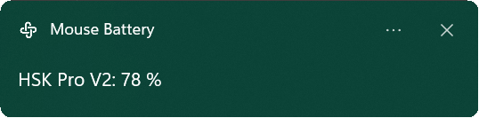

# Mouse Battery

**Know your G-Wolves battery level – without opening any software.**

A tiny, free Windows background app – no window, no tray icon, no account, no tracking.

[**⬇ Download**](../../releases/latest) · [Install in 1 minute](#install) · [💬 Feedback without account](https://docs.google.com/forms/d/e/1FAIpQLScsMFl2yEgZeK9XnnpdxrZ11qGO5dJ4ZLNxyg6os8Y4bVqsmg/viewform) · [🇩🇪 Deutsch](German-Version/README.md)

> 💬 **Your ideas shape this app.** Missing a feature, want a different warning level, or your mouse isn't recognized? [Leave a quick note – no account needed](https://docs.google.com/forms/d/e/1FAIpQLScsMFl2yEgZeK9XnnpdxrZ11qGO5dJ4ZLNxyg6os8Y4bVqsmg/viewform) or [open an issue](../../issues/new/choose) – I read everything and I'm happy to make changes. English or German, no GitHub experience needed.

---

## ✨ What it does

### 🔋 A notification instead of a configurator
When you turn on your PC, a quiet Windows notification tells you the level: **„HSK Pro V2: 80 %“**. After that, every 3 hours. That's it – no web page, no extra program window.

### 🎮 Warnings wait until you leave your game
A low-battery warning is not shown the moment the level drops. It **waits for your next window switch** – pressing the Windows key, Alt+Tab, or clicking another window. So it doesn't pop up while you're aiming; you see it the next time you leave the game anyway. Only at 5 % it comes right away. The regular 3-hour notification also waits while a game or video runs in fullscreen.

### 📸 Every notification at a glance

| Notification | Looks like | When it comes |
|---|---|---|
| **PC start** |  | First answer of the mouse after the PC starts – right away, even in fullscreen. Silent. |
| **Every 3 hours** |  | Nothing in fullscreen: right away, silent. Something in fullscreen: waits for your next window switch. |
| **Mouse woke up** |  | 3 hours are over but the mouse was asleep: the moment you move it – right away **with sound**, even in fullscreen. |
| **Charging** |  | Like the ones above, with a second line while the mouse is charging. |
| **30 %** |  | At your next window switch. Silent. |
| **15 %** |  | At your next window switch. With sound. |
| **10 % and below** |  | At your next window switch. With sound, **stays until you click OK**. Below 10 % it comes again every minute (at your window switches). |
| **5 % and below** |  | **Right away, even in a game**, every minute. With sound, stays until **OK**. |

Each new notification replaces the previous one of the same mouse, and only the newest warning is shown. All warnings reset as soon as you charge. Every level can be changed in the [settings](#️-settings).

> The color comes from your Windows accent color – see the [FAQ](#-faq).

### 🖱️ All G-Wolves wireless mice, recognized automatically
Plug in the receiver (or the cable) – the app finds the mouse and uses its real name. Several mice at the same time work too; each gets its own notification.

---

## 🧰 Everything else
- Only **reads** the battery level. It never sends anything that changes your mouse settings.
- **Works completely offline** – it never connects to the internet. Everything it needs is inside the `.exe`.
- Uses very little memory and practically 0 % CPU.
- English and German – follows your Windows language.
- Double-click the app while it's running → shows the current level right away.
- Writes a small history (`history.csv`) so you can see how long a charge lasts.

## Install
1. [**Download**](../../releases/latest) `MouseBattery.exe`.
2. Double-click it and answer **Yes**.
3. Done – it now runs in the background and starts with Windows.

No admin rights and no .NET installation needed. Windows 10 or 11 (64-bit).

> **Windows SmartScreen** may warn you because the file is new and not signed. Click **More info** → **Run anyway**. The full source code is in this repository, and the `.exe` is built by GitHub Actions from it.

**Uninstall:** *Settings → Apps → Installed apps → Mouse Battery → Uninstall*.

## 🖱️ Supported mice

### Tested it with your mouse? Tell me in 10 seconds – no account: [**👉 Works / doesn't work**](https://docs.google.com/forms/d/e/1FAIpQLScsMFl2yEgZeK9XnnpdxrZ11qGO5dJ4ZLNxyg6os8Y4bVqsmg/viewform)

Every G-Wolves model the official web configurator knows (as of November 2026) is built in. ✅ = confirmed by a real user. Click a ❔ to confirm yours – every answer helps the next person.

| Mouse | Status |
|---|---|
| Fenrir | [❔ not confirmed yet – tested it?](https://docs.google.com/forms/d/e/1FAIpQLScsMFl2yEgZeK9XnnpdxrZ11qGO5dJ4ZLNxyg6os8Y4bVqsmg/viewform) |
| Fenrir Asym | [❔ not confirmed yet – tested it?](https://docs.google.com/forms/d/e/1FAIpQLScsMFl2yEgZeK9XnnpdxrZ11qGO5dJ4ZLNxyg6os8Y4bVqsmg/viewform) |
| Fenrir Max | [❔ not confirmed yet – tested it?](https://docs.google.com/forms/d/e/1FAIpQLScsMFl2yEgZeK9XnnpdxrZ11qGO5dJ4ZLNxyg6os8Y4bVqsmg/viewform) |
| Fenrir Max Asym | [❔ not confirmed yet – tested it?](https://docs.google.com/forms/d/e/1FAIpQLScsMFl2yEgZeK9XnnpdxrZ11qGO5dJ4ZLNxyg6os8Y4bVqsmg/viewform) |
| **Fenrir Pro** | ✅ confirmed (Receiver RS) |
| HSK Lite | [❔ not confirmed yet – tested it?](https://docs.google.com/forms/d/e/1FAIpQLScsMFl2yEgZeK9XnnpdxrZ11qGO5dJ4ZLNxyg6os8Y4bVqsmg/viewform) |
| HSK Plus | [❔ not confirmed yet – tested it?](https://docs.google.com/forms/d/e/1FAIpQLScsMFl2yEgZeK9XnnpdxrZ11qGO5dJ4ZLNxyg6os8Y4bVqsmg/viewform) |
| HSK Plus ACE | [❔ not confirmed yet – tested it?](https://docs.google.com/forms/d/e/1FAIpQLScsMFl2yEgZeK9XnnpdxrZ11qGO5dJ4ZLNxyg6os8Y4bVqsmg/viewform) |
| HSK Pro | [❔ not confirmed yet – tested it?](https://docs.google.com/forms/d/e/1FAIpQLScsMFl2yEgZeK9XnnpdxrZ11qGO5dJ4ZLNxyg6os8Y4bVqsmg/viewform) |
| HSK Pro ACE | [❔ not confirmed yet – tested it?](https://docs.google.com/forms/d/e/1FAIpQLScsMFl2yEgZeK9XnnpdxrZ11qGO5dJ4ZLNxyg6os8Y4bVqsmg/viewform) |
| **HSK Pro V2** | ✅ confirmed |
| HT-S2 | [❔ not confirmed yet – tested it?](https://docs.google.com/forms/d/e/1FAIpQLScsMFl2yEgZeK9XnnpdxrZ11qGO5dJ4ZLNxyg6os8Y4bVqsmg/viewform) |
| HT-S2 Pro | [❔ not confirmed yet – tested it?](https://docs.google.com/forms/d/e/1FAIpQLScsMFl2yEgZeK9XnnpdxrZ11qGO5dJ4ZLNxyg6os8Y4bVqsmg/viewform) |
| HTM Plus | [❔ not confirmed yet – tested it?](https://docs.google.com/forms/d/e/1FAIpQLScsMFl2yEgZeK9XnnpdxrZ11qGO5dJ4ZLNxyg6os8Y4bVqsmg/viewform) |
| HTR | [❔ not confirmed yet – tested it?](https://docs.google.com/forms/d/e/1FAIpQLScsMFl2yEgZeK9XnnpdxrZ11qGO5dJ4ZLNxyg6os8Y4bVqsmg/viewform) |
| HTR Pro | [❔ not confirmed yet – tested it?](https://docs.google.com/forms/d/e/1FAIpQLScsMFl2yEgZeK9XnnpdxrZ11qGO5dJ4ZLNxyg6os8Y4bVqsmg/viewform) |
| HTS Plus | [❔ not confirmed yet – tested it?](https://docs.google.com/forms/d/e/1FAIpQLScsMFl2yEgZeK9XnnpdxrZ11qGO5dJ4ZLNxyg6os8Y4bVqsmg/viewform) |
| HTS Plus ACE | [❔ not confirmed yet – tested it?](https://docs.google.com/forms/d/e/1FAIpQLScsMFl2yEgZeK9XnnpdxrZ11qGO5dJ4ZLNxyg6os8Y4bVqsmg/viewform) |
| HTS Plus Pro | [❔ not confirmed yet – tested it?](https://docs.google.com/forms/d/e/1FAIpQLScsMFl2yEgZeK9XnnpdxrZ11qGO5dJ4ZLNxyg6os8Y4bVqsmg/viewform) |
| HTS Ultra | [❔ not confirmed yet – tested it?](https://docs.google.com/forms/d/e/1FAIpQLScsMFl2yEgZeK9XnnpdxrZ11qGO5dJ4ZLNxyg6os8Y4bVqsmg/viewform) |
| HTX | [❔ not confirmed yet – tested it?](https://docs.google.com/forms/d/e/1FAIpQLScsMFl2yEgZeK9XnnpdxrZ11qGO5dJ4ZLNxyg6os8Y4bVqsmg/viewform) |
| HTX ACE | [❔ not confirmed yet – tested it?](https://docs.google.com/forms/d/e/1FAIpQLScsMFl2yEgZeK9XnnpdxrZ11qGO5dJ4ZLNxyg6os8Y4bVqsmg/viewform) |
| HTX Mini | [❔ not confirmed yet – tested it?](https://docs.google.com/forms/d/e/1FAIpQLScsMFl2yEgZeK9XnnpdxrZ11qGO5dJ4ZLNxyg6os8Y4bVqsmg/viewform) |
| HTX Mini Asym | [❔ not confirmed yet – tested it?](https://docs.google.com/forms/d/e/1FAIpQLScsMFl2yEgZeK9XnnpdxrZ11qGO5dJ4ZLNxyg6os8Y4bVqsmg/viewform) |
| HTXU | [❔ not confirmed yet – tested it?](https://docs.google.com/forms/d/e/1FAIpQLScsMFl2yEgZeK9XnnpdxrZ11qGO5dJ4ZLNxyg6os8Y4bVqsmg/viewform) |
| Lycan | [❔ not confirmed yet – tested it?](https://docs.google.com/forms/d/e/1FAIpQLScsMFl2yEgZeK9XnnpdxrZ11qGO5dJ4ZLNxyg6os8Y4bVqsmg/viewform) |
| VUK | [❔ not confirmed yet – tested it?](https://docs.google.com/forms/d/e/1FAIpQLScsMFl2yEgZeK9XnnpdxrZ11qGO5dJ4ZLNxyg6os8Y4bVqsmg/viewform) |
| VUK Mini | [❔ not confirmed yet – tested it?](https://docs.google.com/forms/d/e/1FAIpQLScsMFl2yEgZeK9XnnpdxrZ11qGO5dJ4ZLNxyg6os8Y4bVqsmg/viewform) |
| WARG | [❔ not confirmed yet – tested it?](https://docs.google.com/forms/d/e/1FAIpQLScsMFl2yEgZeK9XnnpdxrZ11qGO5dJ4ZLNxyg6os8Y4bVqsmg/viewform) |

Not working, or your mouse is missing? Use [the same form](https://docs.google.com/forms/d/e/1FAIpQLScsMFl2yEgZeK9XnnpdxrZ11qGO5dJ4ZLNxyg6os8Y4bVqsmg/viewform) or [open an issue](../../issues/new/choose) – a new mouse is often only one line of code.

## ⚙️ Settings
Settings live in `%LOCALAPPDATA%\MouseBattery\config.json` (paste that into the Explorer address bar). Change a value, then restart the app (or sign out and back in).

| Setting | Default | Meaning |
|---|---|---|
| `Language` | `auto` | `auto`, `en` or `de` |
| `InfoEveryHours` | `3` | how often the normal level notification comes |
| `FirstWarningPercent` | `30` | silent warning |
| `SecondWarningPercent` | `15` | warning with sound |
| `ThirdWarningPercent` | `10` | warning that stays until **OK** |
| `ImmediatePercent` | `5` | warning right away, even in a game |
| `RepeatSeconds` | `60` | repeat interval below 10 % |
| `CheckIntervalSeconds` | `10` | how often the battery is read |
| `WarningSound` | `""` | optional own `.wav` for notifications with sound (wake-up, 15 %) |
| `UrgentSound` | `""` | optional own `.wav` for urgent warnings (10 % and below) |
| `MouseNames` | `{}` | own names, e.g. `{ "5817": "My HSK" }` (product ID from `log.txt`) |

## ❓ FAQ

**I don't get any notification.**
Check that notifications are on for *Mouse Battery* in *Settings → System → Notifications*, and that *Do not disturb* is off. The log is in `%LOCALAPPDATA%\MouseBattery\log.txt`.

**Why is the notification green in the screenshots?**
Windows paints notifications in your **accent color**. The screenshots are green only because the maintainer's accent color is green – on your PC they appear in your own color (*Settings → Personalization → Colors*).

**I don't hear a sound.**
The app has no sound of its own – it uses the Windows notification sound from your sound scheme (*Notification*, and *Reminder* for notifications with an **OK** button). If you picked your own `.wav` file that lies **outside `C:\Windows\Media`**, notifications stay silent: the Windows notification service isn't allowed to read such files. This affects every app, not only this one. Fix: copy the `.wav` into `C:\Windows\Media` and select it again in the sound scheme (*Control Panel → Sound → Sounds*).

**I muted all notification sounds, but I still want a sound for my mouse.**
Set `WarningSound` and/or `UrgentSound` in the [settings](#️-settings) to a `.wav` file, e.g. `"UrgentSound": "C:\\Windows\\Media\\Alarm01.wav"` (double backslashes). Then the notification itself stays silent and the app plays your file – also when all Windows notification sounds are off. Leave them empty for the normal Windows sound. Silent notifications (PC start, 30 %) stay silent.

**It says the mouse is asleep.**
G-Wolves mice sleep after a short idle time and can't answer then. Move the mouse – the level comes as soon as it wakes up.

**Can it break my mouse or change my settings?**
No. It only sends the same *read battery* request the official web configurator sends. No settings, no firmware.

**Does it work together with the official configurator?**
Yes. If both talk to the mouse at the very same moment, one reading may simply be skipped.

**Is it an anti-cheat risk?**
It doesn't read keys, doesn't inject anything into games and doesn't hook input. It only notices *that* the foreground window changed (a normal Windows event).

**Why is the .exe 11 MB?**
It contains the .NET runtime, so you don't need to install anything.

## 🙏 Credits
The battery protocols were worked out by reading these projects – thanks! No code was copied.
- [quenTiago/windows-taskbar-battery](https://github.com/quenTiago/windows-taskbar-battery)
- [maximelonguepe/gwolves-battery-overlay](https://github.com/maximelonguepe/gwolves-battery-overlay) (protocol documentation)
- The model list comes from the device list the public G-Wolves web configurator loads in the browser.

## ⚠️ Disclaimer
This is an **unofficial** community project. It is **not made, endorsed or supported by G-Wolves**. „G-Wolves“, the G-Wolves logo and the model names are trademarks of their owner. They are only used to say which mice are supported, and the logo only appears inside the notifications so you can see at a glance which mouse they are about. Use at your own risk.

## 🗺️ Ideas for later
Not built yet – just plans. Tell me which ones you'd like to see first ([no account](https://docs.google.com/forms/d/e/1FAIpQLScsMFl2yEgZeK9XnnpdxrZ11qGO5dJ4ZLNxyg6os8Y4bVqsmg/viewform) or [issue](../../issues/new/choose)).

- **Click a notification → open the configurator.** Clicking a notification opens a small page in your default browser where you pick which official G-Wolves web configurator to start (there are several). One more click and the configurator opens in a new tab. The app itself would still never go online – your browser only opens when you click.

## 💬 Feedback & ideas
**This project lives from your feedback.** Bug, new mouse, a wish, or just „would be nice if…“? [Open an issue](../../issues/new/choose) – every suggestion is read, and I'm genuinely happy to build what you need. Even small things like a different text or sound are welcome. Pull requests too, see [CONTRIBUTING](CONTRIBUTING.md). If it helps you, a ⭐ is appreciated.

## How it's made
Planned and tested by its maintainer and written with the help of **Claude**, Anthropic's AI assistant.

## License
MIT – see [LICENSE](LICENSE).
